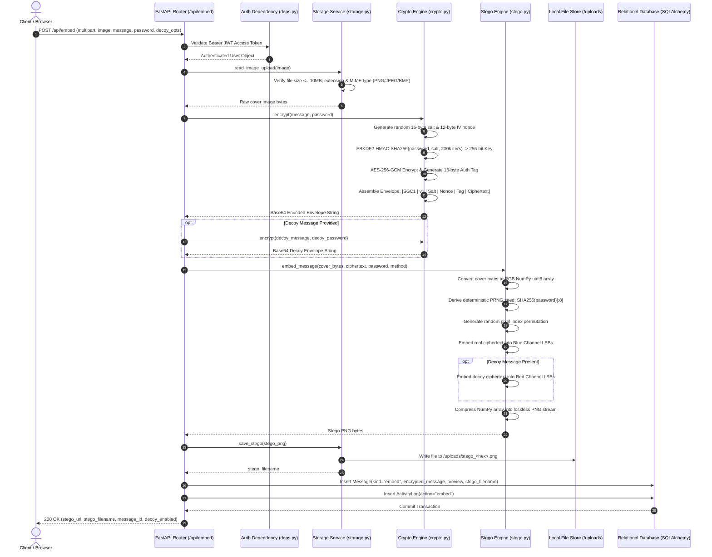
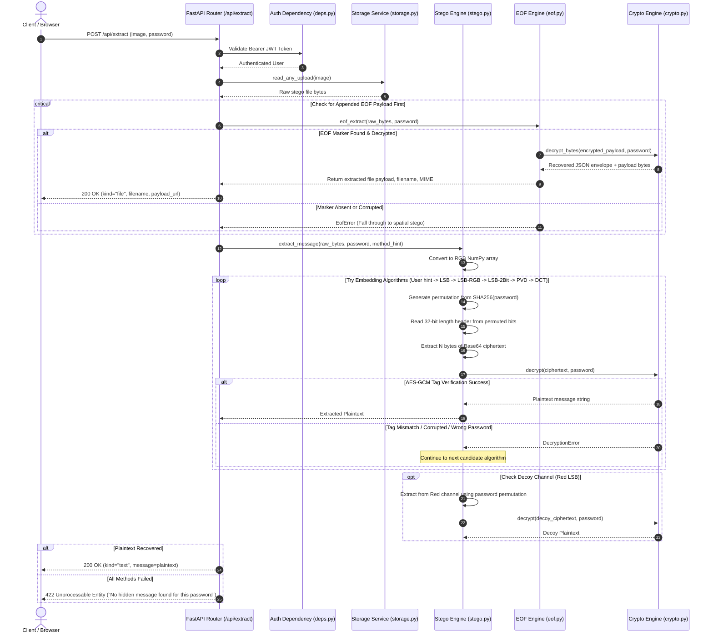
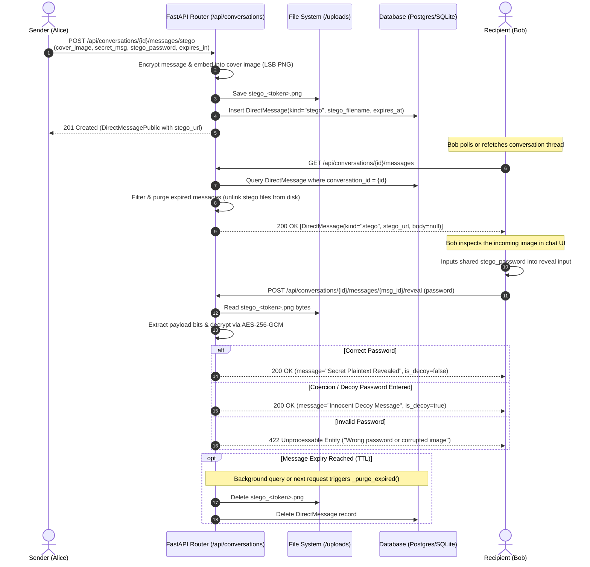
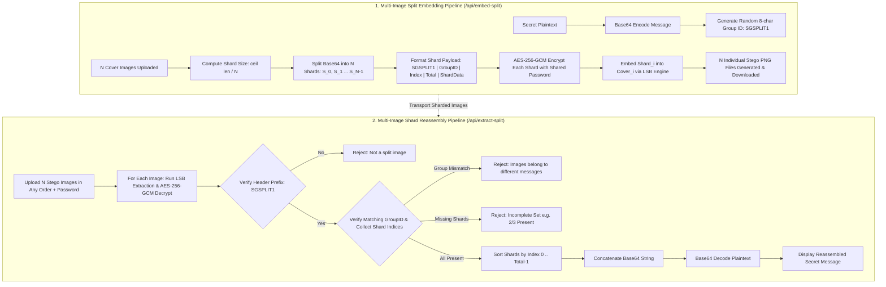
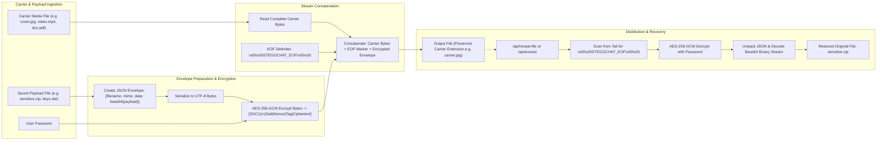
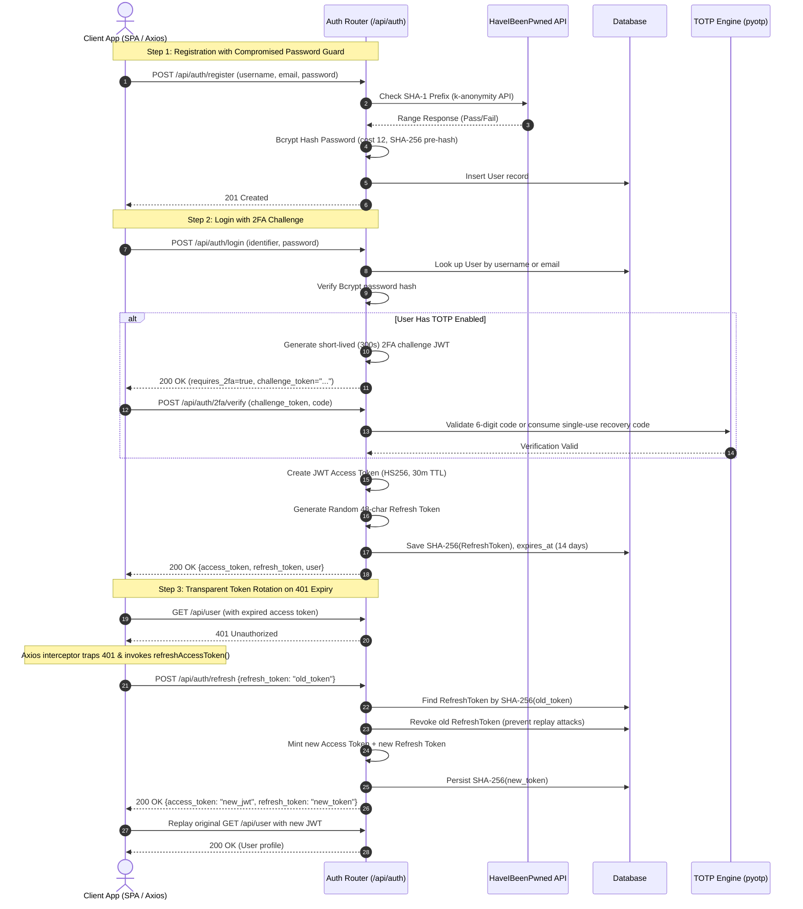

# StegoChat Architecture and Data/Control Flows

## 1. Executive Architectural Summary

StegoChat is an enterprise-grade, defense-in-depth secure steganography and covert communications platform. It combines modern authenticated symmetric cryptography (**AES-256-GCM**) with advanced media steganography (spatial domain **LSB**, **LSB-RGB**, **LSB-2Bit**, **Pixel Value Differencing (PVD)**, transform domain **Discrete Cosine Transform (DCT)**, and **Universal EOF File Concealment**). 

The platform is designed around zero-knowledge server persistence for plaintexts: **the server never persists plaintext messages or message encryption passwords**. All message histories, database records, and carrier payloads store ciphertext exclusively, derived through password-authenticated key derivation functions with high iteration counts.

```
┌────────────────────────────────────────────────────────────────────────────────────────┐
│                                   CLIENT TIERS                                         │
│  ┌─────────────────────────────────────────┐  ┌─────────────────────────────────────┐  │
│  │     React 18 SPA (Vite + TypeScript)    │  │       External Token Readers        │  │
│  │   Zustand · React Query · Tailwind CSS  │  │  Anonymous / Public Redeem Clients │  │
│  └────────────────────┬────────────────────┘  └──────────────────┬──────────────────┘  │
└───────────────────────┼──────────────────────────────────────────┼─────────────────────┘
                        │ HTTPS / WSS / REST API                   │ HTTP GET/POST
                        ▼                                          ▼
┌────────────────────────────────────────────────────────────────────────────────────────┐
│                              REVERSE PROXY & GATEWAY                                   │
│                        Nginx 1.27 (Alpine) Reverse Proxy                               │
│      - Rate Limiting Shield         - TLS / HSTS Termination                           │
│      - Static Asset Caching         - Security Headers (CSP, X-Frame-Options: DENY)    │
│      - Reverse Proxy `/api/*`       - SPA Fallback (`try_files $uri /index.html`)      │
└───────────────────────────────────────┬────────────────────────────────────────────────┘
                                        │ Forwarded HTTP Requests
                                        ▼
┌────────────────────────────────────────────────────────────────────────────────────────┐
│                              APPLICATION BACKEND ENGINE                                │
│                     FastAPI 0.115+ / Uvicorn ASGI Server                               │
│  ┌──────────────────────────────────────────────────────────────────────────────────┐  │
│  │ Middleware: SlowAPI (Rate Limiter) · SecurityHeaders · CORSMiddleware             │  │
│  └────────────────────────────────────────┬─────────────────────────────────────────┘  │
│                                           │                                            │
│  ┌──────────────────┐  ┌──────────────────┴─┐  ┌─────────────────┐  ┌────────────────┐ │
│  │  Routers / APIs  │  │   Core Domain Logic│  │ Services Layer  │  │ Data / Models  │ │
│  │  - auth          │  │   - crypto (GCM)   │  │ - storage.py    │  │ - User         │ │
│  │  - stego         │  │   - stego (5 algs) │  │ - mail.py (API) │  │ - Chat/Message │ │
│  │  - conversations │  │   - eof            │  │ - activity.py   │  │ - Conversation │ │
│  │  - tokens        │  │   - forensics      │  │                 │  │ - ShareToken   │ │
│  │  - dead_drop     │  │   - totp / pwned   │  │                 │  │ - DeadDrop     │ │
│  └────────┬─────────┘  └────────────────────┘  └─────────────────┘  └────────┬───────┘ │
└───────────┼──────────────────────────────────────────────────────────────────┼─────────┘
            │                                                                  │
            ▼                                                                  ▼
┌─────────────────────────┐                                        ┌─────────────────────┐
│  PERSISTENT FILE STORE  │                                        │  RELATIONAL DATABASE│
│     `/data/uploads`     │                                        │  PostgreSQL 16 /    │
│  - Stego PNGs           │                                        │  SQLite (Dev)       │
│  - Extracted Payloads   │                                        │  - SQLAlchemy 2 ORM │
│  - Carrier Files        │                                        │  - Alembic Migr.    │
└─────────────────────────┘                                        └─────────────────────┘
```

### 1.1 Architectural Evolution: Legacy (v1) vs Modern (v2)

The repository reflects a clean architectural progression from an initial prototype to a hardened, production-grade microservice architecture:

| Dimension | Legacy Prototype (v1) | Modern Production Architecture (v2) |
|---|---|---|
| **Backend Framework** | Flask 2.x monolithic (`backend/app.py`) | FastAPI 0.115+ ASGI (`backend/app/main.py`) |
| **Frontend Framework** | Static vanilla JS + HTML (`frontend/*.html`) | React 18 SPA + Vite + TypeScript (`frontend/src/`) |
| **Cryptography** | AES-CBC with simple SHA-256 key (`backend/encryption.py`) | Authenticated AES-256-GCM + PBKDF2-HMAC-SHA256 (200k iters) (`backend/app/core/crypto.py`) |
| **Steganography** | Unoptimized Python loops (`backend/stego_engine.py`) | Vectorized NumPy array transforms, 5 embedding algorithms (`backend/app/core/stego.py`) |
| **Data Persistence** | Flat JSON file (`backend/data.json`) | SQLAlchemy 2.0 ORM + SQLite (dev) / PostgreSQL 16 (prod) + Alembic migrations |
| **Session & Auth** | Client-side cookies & plaintext fallback | JWT access tokens (HS256) + SHA-256 rotating refresh tokens + TOTP 2FA |
| **Email Subsystem** | Basic SMTP | Google OAuth2 Gmail API transport with SMTP fallback (`backend/app/services/mail.py`) |

---

## 2. Component Structure & Module Breakdown

### 2.1 Backend Modules (`backend/app/`)

The backend codebase adheres strictly to clean architecture and separation of concerns:

- **`main.py`**: The application composition root. Coordinates the FastAPI lifespan, configures structured logging, mounts SlowAPI rate limiting, registers custom security header middleware (`nosniff`, `DENY` frames, `HSTS`), configures CORS, handles global HTTP exceptions (422, 429, 500), and wires the API router hierarchy.
- **`config.py`**: Centralized configuration management utilizing `pydantic-settings`. Loads environment variables prefixed with `STEGOCHAT_` from `.env` files or the container environment, enforcing type validation and safe fallback defaults.
- **`database.py`**: SQLAlchemy 2.0 database engine and session factory (`SessionLocal`). Provides the scoped session dependency `get_db()` and executes automatic non-destructive column backfills for developer SQLite databases while supporting managed Alembic schema migrations for PostgreSQL.
- **`core/` (Domain Logic Layer - Framework Agnostic)**:
  - **`crypto.py`**: Low-level cryptographic primitive suite. Implements authenticated AES-256-GCM encryption/decryption, PBKDF2-HMAC-SHA256 key derivation with 200,000 iterations, and packing into binary/base64 cryptographic envelopes (`MAGIC: SGC1`, version byte, 16-byte salt, 12-byte nonce, 16-byte authentication tag).
  - **`stego.py`**: Core steganography engine. Houses five discrete spatial and frequency embedding implementations, decoy red-channel multiplexing, payload bit packing, seeded pseudo-random permutations, and multi-image split/merge pipelines.
  - **`eof.py`**: Universal append-after-EOF steganography handler. Injects arbitrary files behind carrier image/media bytes using a signature delimiter (`\x00\x00STEGOCHAT_EOF\x00\x00`) and an AES-256-GCM encrypted JSON metadata manifest.
  - **`forensics.py`**: Steganalysis and forensic inspection suite. Computes Shannon entropy over byte distributions, analyzes least-significant-bit density deviations from natural 0.5 uniformity, detects EOF markers, and runs regex heuristics for credential leak prevention.
  - **`security.py`**: Password hashing via Bcrypt with 72-byte pre-hashing via SHA-256, access token creation/verification via `python-jose`, and refresh token SHA-256 hashing.
  - **`totp.py`**: Time-based one-time password engine based on `pyotp`. Handles RFC 6238 secret generation, QR provisioning URIs, clock-drift verification, single-use recovery code hashing, and challenge token exchange.
  - **`pwned.py`**: Client for the HaveIBeenPwned k-anonymity SHA-1 API. Blocks compromised passwords during registration and password change requests.
  - **`rate_limit.py`**: Rate-limiting definitions powered by `slowapi` and `limits`.
  - **`deps.py`**: FastAPI dependency injection functions (`get_current_user`, `get_current_admin`).
- **`models/` (Data Persistence Layer)**:
  - `User`: Accounts, credentials, roles, email verification status, TOTP/2FA secrets, and recovery code hashes.
  - `Setting`: Per-user visual and behavioral preferences (theme, accent, encryption algorithm, preferred stego method).
  - `Chat` & `Message`: Historical steganography sessions (storing ciphertext and generated stego filenames).
  - `Conversation`, `ConversationMember`, `DirectMessage`: Peer-to-peer and group messaging threads with optional stego attachments and ephemeral auto-expiration timers.
  - `ShareToken`: Capability-based URLs with unguessable keys, download quotas, access password hashes, and expiration timestamps.
  - `DeadDrop`: One-time burn-after-read secret storage with TTL expiration.
  - `RefreshToken` & `OneTimeToken`: Cryptographic session persistence and single-use verification tokens.
  - `ActivityLog`: Comprehensive audit trail tracking user events, timestamps, and client IP addresses.
- **`routers/` (HTTP API Layer)**:
  - `auth.py`: User registration, login, token refresh with rotation, logout, 2FA challenge resolution, password reset, and email OTP verification.
  - `stego.py`: Image embedding (`/embed`), image extraction (`/extract`), multi-image splitting (`/embed-split`, `/extract-split`), universal file hiding (`/hide-file`, `/reveal-file`), message scanning (`/scan-risk`), forensic analysis (`/forensics`), and capacity calculation (`/capacity`).
  - `conversations.py`: Direct messaging, group creation, member management, read-state cursors, stego message attachments, and ephemeral message auto-purging.
  - `share_tokens.py`: Token creation, metadata lookup, password verification, file redemption, and revocation.
  - `dead_drop.py`: Anonymous and authenticated dead drop creation, metadata inspection, and burn-on-read access.
  - `history.py`: Retrieval, search, folder organization, and deletion of personal embed/extract logs.
  - `dashboard.py`: User metrics, daily activity aggregation, and storage usage summaries.
  - `files.py`: Secure static file streaming for generated stego assets and sample cover images with path-traversal prevention.
- **`services/` (Infrastructure Integrations)**:
  - `storage.py`: File storage abstraction, disk directory verification, MIME-type and extension validation, and filename sanitization.
  - `mail.py`: Multi-provider transactional email service utilizing the Google Gmail API (OAuth2) with graceful fallback to standard SMTP or local mock logging.
  - `activity.py`: Asynchronous audit log emitter.

### 2.2 Frontend Architecture (`frontend/src/`)

- **State Management (`src/store/`)**:
  - `auth.ts`: Zustand store with `persist` middleware storing the authenticated `User`, JWT access token, and refresh token in `localStorage`.
  - `theme.ts`: UI theme selection (`dark`, `light`, `system`) and accent color palette switching.
  - `ui.ts`: Global modal, sidebar, and notification UI states.
- **Networking & API Client (`src/api/client.ts` & `src/api/services.ts`)**:
  - Centralized Axios instance with authorization header injection.
  - Transparent 401 response interceptor implementing queue-safe refresh token rotation: automatically pauses failing queries, calls `/api/auth/refresh`, updates tokens, and replays pending HTTP requests without user interruption.
- **View Hierarchy (`src/pages/` & `src/components/`)**:
  - `Chat.tsx`: Direct and group messaging UI with inline encrypted stego message composer, sample picker, password input, inline message decryptor, and self-destruct timers.
  - `Studio.tsx`: Steganography workspace supporting single-image embed/extract, multi-image split/merge, universal file concealment, live capacity bars, and QR code share modal.
  - `Forensics.tsx`: Visual forensic inspection tool displaying Shannon entropy, LSB anomaly graphs, file metadata, and risk warnings.
  - `Tokens.tsx` & `ShareRedeem.tsx`: Token management table and public-facing anonymous redemption page.
  - `Dashboard.tsx`, `History.tsx`, `Settings.tsx`: Analytics, message archives, and account/2FA configuration.

---

## 3. End-to-End Data & Control Flowsheets

### 3.1 Carrier Media Ingestion, Encryption, and Embedding

The following diagram illustrates the complete pipeline when a user submits plaintext, a secret password, and an image to create a steganographic carrier.



---

### 3.2 Steganographic Extraction and Decryption Flow

The extraction pipeline recovers hidden payloads while defending against corrupted data or incorrect passwords via GCM tag authentication.



---

### 3.3 Peer-to-Peer & Group Chat Steganography Lifecycle

In direct messaging, StegoChat integrates cover images directly into the chat flow, maintaining sender confidentiality and supporting message expiration and burn-on-read mechanics.



---

### 3.4 Multi-Image Split Embedding & Shard Reassembly Workflow

When secret payloads exceed the bit capacity of a single cover image, StegoChat splits the payload across multiple carrier images using a sharded envelope protocol.



---

### 3.5 Universal Carrier File Hiding (EOF Injection Pipeline)

StegoChat supports hiding *any* arbitrary file type (ZIP, PDF, MP4, EXE) inside *any* valid media carrier using append-after-EOF steganography.



---

### 3.6 Authentication Lifecycle, Token Rotation & Multi-Factor Auth

StegoChat uses JWT access tokens, database-backed SHA-256 rotating refresh tokens, and optional two-factor authentication (TOTP or Email OTP).



---

## 4. Steganography Algorithms & Cryptographic Specifications

### 4.1 Cryptographic Protocol Matrix

| Property | Implementation Detail |
|---|---|
| **Cipher Algorithm** | AES-256-GCM (Galois/Counter Mode) via `PyCryptodome` |
| **Confidentiality Key Length** | 256 bits (32 bytes) |
| **Authentication Tag** | 128 bits (16 bytes) appended to ciphertext |
| **Initialization Vector (Nonce)** | 96 bits (12 bytes) cryptographically random per message via `get_random_bytes(12)` |
| **Key Derivation Function (KDF)** | PBKDF2-HMAC-SHA256 with 200,000 iterations |
| **Salt** | 128 bits (16 bytes) cryptographically random per message |
| **Cryptographic Envelope Layout** | `MAGIC` (4 bytes: `b"SGC1"`) \| `VERSION` (1 byte: `0x01`) \| `SALT` (16 bytes) \| `NONCE` (12 bytes) \| `TAG` (16 bytes) \| `CIPHERTEXT` (variable) |
| **Integrity Guarantee** | AEAD authentication tag guarantees that bitflips, password mismatches, or truncated data trigger explicit errors rather than silent corruption. |

### 4.2 Steganography Methods Comparison

```
+---------------------------------------------------------------------------------------+
| METHOD 1: LSB (Least Significant Bit - Blue Channel Permuted)                         |
| Bit Capacity: (Width * Height * 1) / 8 - 4 bytes                                      |
| Mechanics: Ciphertext bits overwrite bit 0 of the Blue channel across a pseudo-random |
|            pixel permutation seeded by SHA256(password). Decoy message resides in Red.|
+---------------------------------------------------------------------------------------+
| METHOD 2: LSB-RGB (All Channels Permuted)                                             |
| Bit Capacity: (Width * Height * 3) / 8 - 4 bytes  [3x Capacity Boost]                 |
| Mechanics: Flattens image to (N * 3) stream (R0, G0, B0, R1, G1, B1...). Overwrites    |
|            bit 0 of all channels along a permutation seeded by SHA256(password + ":rgb").|
+---------------------------------------------------------------------------------------+
| METHOD 3: LSB-2BIT (2 Bits Per Pixel - Blue Channel)                                  |
| Bit Capacity: (Width * Height * 2) / 8 - 4 bytes  [2x Capacity Boost]                 |
| Mechanics: Replaces bits 0 and 1 (mask 0xFC) in Blue channel. Pairs of bits packed   |
|            into 2-bit values (0-3). Permutation seeded by SHA256(password + ":2bit"). |
+---------------------------------------------------------------------------------------+
| METHOD 4: PVD (Pixel Value Differencing)                                              |
| Bit Capacity: (NumPairs * 3) / 8 - 4 bytes                                            |
| Mechanics: Considers adjacent pixel pairs (p1, p2). Encodes 3 secret bits into the     |
|            difference |p2 - p1| & ~7 | secret_bits. Adjusts boundary pixels cleanly.   |
+---------------------------------------------------------------------------------------+
| METHOD 5: DCT (Discrete Cosine Transform - Frequency Domain)                          |
| Bit Capacity: (8x8 Blocks * 16 mid-freq positions) / 8 - 4 bytes                      |
| Mechanics: Computes 2D orthonormal 8x8 DCT-II on Blue blocks. Modifies mid-frequency  |
|            zigzag coefficients (bands 4-7) with quant step Q=20. Survives minor noise.|
+---------------------------------------------------------------------------------------+
| METHOD 6: UNIVERSAL EOF (Append-After-EOF File Injection)                             |
| Bit Capacity: Arbitrary (Bounded only by system max_carrier_bytes = 64MB)              |
| Mechanics: Appends delimiter \x00\x00STEGOCHAT_EOF\x00\x00 followed by AES-256-GCM   |
|            encrypted JSON envelope. Carrier renders normally in media viewers.        |
+---------------------------------------------------------------------------------------+
```

---

## 5. Security Architecture & Threat Boundaries

1. **Zero Plaintext Persistence**: Plaintext messages and passwords exist exclusively in volatile process memory during request processing. Only AES-256-GCM ciphertext is saved to disk and database.
2. **Database Leak Resilience**:
   - Passwords stored as Bcrypt hashes (with 72-byte SHA-256 pre-hash to avoid truncation attacks).
   - Refresh tokens stored as SHA-256 hashes (`token_hash`), preventing stolen database dumps from being used directly against the `/api/auth/refresh` endpoint.
   - TOTP recovery codes stored as SHA-256 hash arrays.
3. **Plausible Deniability (Deniable Encryption)**: The dual-channel LSB embedding isolates the real payload in the Blue channel and the decoy payload in the Red channel. An adversary possessing the decoy password can only locate and decrypt the Red channel payload, with no mathematical proof of the Blue channel payload's existence.
4. **Transport & Network Hardening**:
   - Strict HTTP security headers configured in `main.py` and `nginx.conf`: `X-Content-Type-Options: nosniff`, `X-Frame-Options: DENY`, `Referrer-Policy: strict-origin-when-cross-origin`, `Strict-Transport-Security: max-age=31536000; includeSubDomains`.
   - Rate limiting via `slowapi` enforces strict throughput quotas: 10 requests/min on auth endpoints, 30 requests/min on steganography endpoints, and 120 requests/min globally.
